# Bike-share "no dock to return to": edge reporting + an off-peak dispatch algorithm (proof of concept)

**In one paragraph.** When a bike-share station is full, bikes end up parked outside the docks, and the official station data cannot see them. This study replays public station data to estimate how a few trucks, working off-peak along forward routes inside 2 km circles, could pre-position bikes before the peak, and how a Bluetooth "temporary return" could make the unseen bikes visible. It is an algorithmic replay, not operating results; nothing is deployed in the field.

**The conclusion holds only under an assumption.** If 4,262 bikes are assumed to be parked off-dock (a self-estimated upper bound, not a measurement), about 3.7 trucks per time slot (120-minute deadline, no stop time, 96-circle replay) could move the part of the shortage that can be moved directly within 2 km (a replay average of 8%–26%); the rest is assumed to be covered by re-docking the off-dock bikes at peak. With 0 off-dock bikes assumed, the weekday 15:30 shortage is still about 522.7 bikes. The result depends entirely on this assumption (sensitivity table below and in [METHOD.md](./METHOD.md)).

**Status: proof of concept.** Bench prototype and replay only. This is independent research: the author is not a party to any operator or government contract and has no authorization from any operator.

## At a glance

| Question | Short answer |
|---|---|
| What is the problem? | Official station data records only docked bikes; bikes parked beside a full station do not exist in the data. |
| What does this study do? | Replays public data (2026-07-21 to 10-15, 280 clean time slots, 96 two-kilometre circles) and estimates the trucks needed to cover the shortage off-peak. |
| Main number | About 3.7 trucks per time slot within a 120-minute deadline (7.9 at 60 minutes, 2.6 at 180), **assuming 4,262 off-dock bikes**; no stop time and straight-line distances, so it is closer to a lower bound than a forecast. Computed only for this one assumption. |
| What do the trucks actually cover? | Only the part of the shortage that can be moved directly within 2 km: about 8%–26% on average in the replay. The rest is assumed to be covered by the off-dock (reserve) bikes being re-docked at peak. |
| How strong is the evidence? | Replay estimates with no counterfactual and no field validation; the off-dock count is an assumption. |
| What is the edge device? | A concept: a Bluetooth unit on the bike plus a "virtual dock" that records a temporary return in this study's own log. Bench-tested only. |
| Is it deployed? | No. It must not be installed on operator vehicles without the operator's authorization. |
| Who is the author? | An independent researcher in Taiwan, not affiliated with any operator or government agency. |

## Contents

| File | What it is |
|---|---|
| [METHOD.md](./METHOD.md) | The algorithm rules, edge device, sensitivity table and limitations |
| [youbike_edge_dispatch_deck_20261021.pdf](./youbike_edge_dispatch_deck_20261021.pdf) | Slide deck (20 pages) |
| [architecture/](./architecture/) | 7 architecture diagrams (SVG): overview, five layers, and the dispatch-logic decoupling diagram |
| [console/](./console/) | 3 screenshots of the local console (data batch 2026-10-21 22:25, captured 23:04); the console UI itself is in Traditional Chinese. These are a different batch from deck page 14 (18:59), so numbers are not directly comparable |
| [LICENSE](./LICENSE), [NOTICE.md](./NOTICE.md) | Official CC BY-NC-ND 4.0 text; licence scope and third-party notices |
| [CITATION.cff](./CITATION.cff) | Citation metadata |

## The flow on one diagram

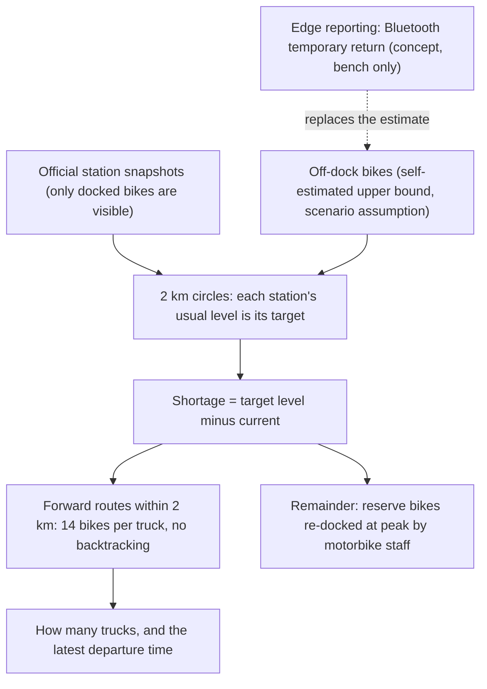

## Architecture at a glance

The work is split into eight layers, each with its own diagram. Five are drawn in this repo (L2, L3, L4, L5, L8); collection (L1), governance (L6) and off-dock reporting (L7) are named only.

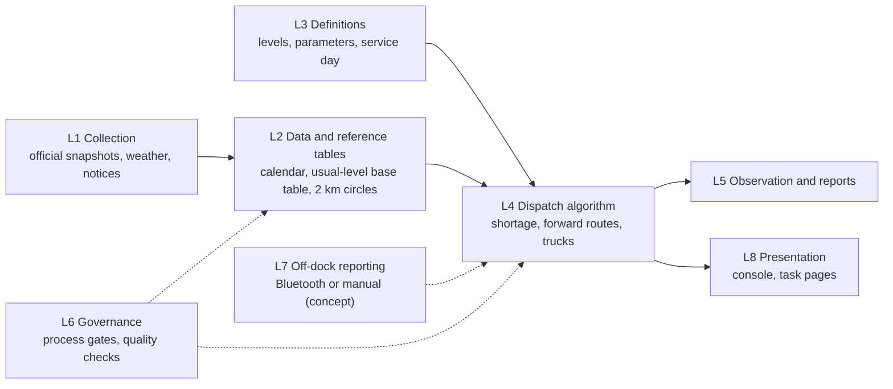

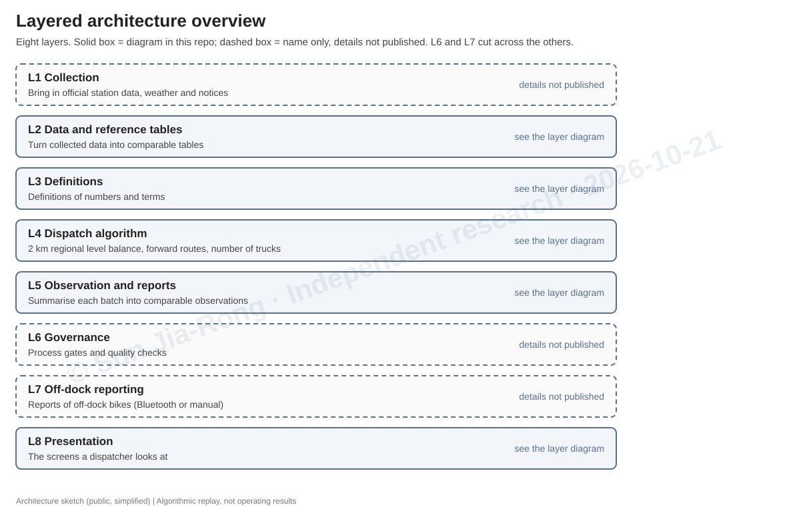

The dispatch logic itself is decoupled into six layers (data, geometry, regional level, forward routing, station, measurement); each depends only on what the layer above hands over:

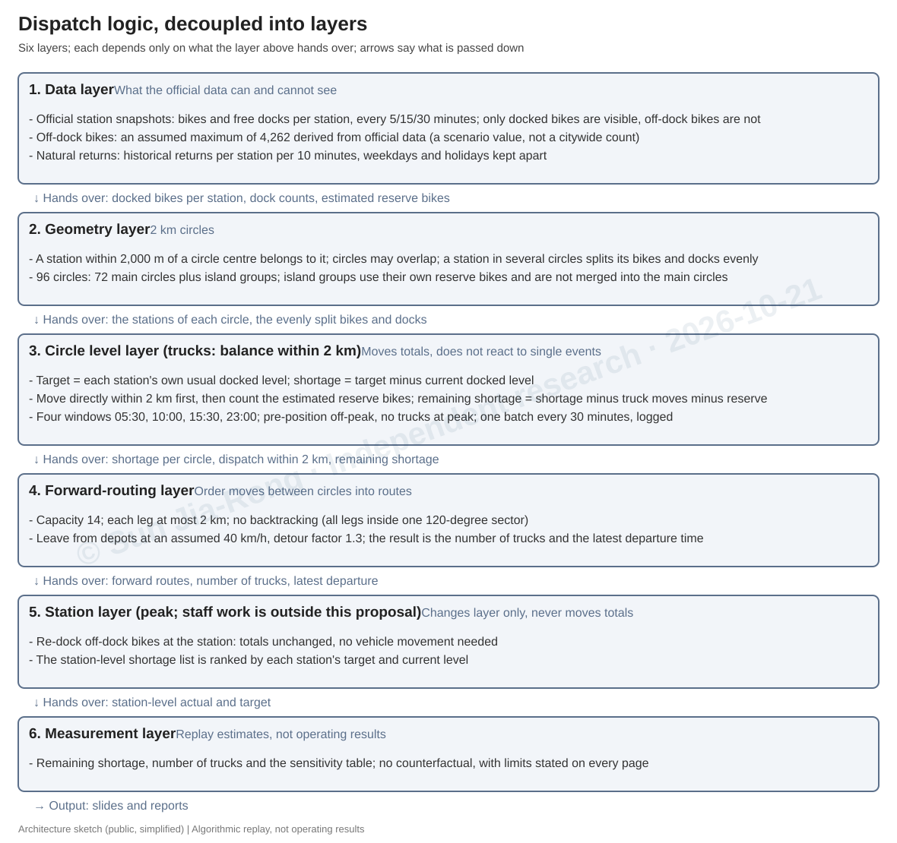

## Why ask the question differently

Bike-share station data is public, and in the author's observation it is a common topic in hackathons and data contests (not counted year by year). The usual approach is to predict which station will run short. But station data only records docked bikes; bikes parked outside the docks are not in the data. This study asks a different question: how should the layer you cannot see be pre-positioned?

## The problem

When a station has no free dock, the bike cannot be returned. It is parked beside the docks and staff must come; billing is extended meanwhile (operator customer-service description and user reports; the operator's notices are authoritative). Official station data records only docked bikes, so off-dock bikes do not exist in the data, and the data can disagree with the field.

A field example (one station, one moment, counted by eye; not a distribution and not a citywide average): a station in Taoyuan on 2026-09-17 had 25 docks with another 20 bikes parked outside. It shows that the phenomenon exists, can be counted, and cannot be expressed by the official station fields.

## Why the shortage persists

- Official figures: from end-2023 to end-2025 stations grew +8.4% and bikes +3.2% (−0.8 bikes per station). From end-2025 to 2026-09-30 stations grew +7.3% and the published bike count +0.0% (the bike column may not have been updated). The author's daily snapshots show docks +2.7% from 07-21 to 10-16; bikes are not published, so this series says nothing about bikes. The total number of docks is not officially published, so the station count is a proxy. (Source years are ROC years 112, 114 and 115.)
- The NT$5 ride voucher scheme ("友愛接力") was followed by lower counts: in Taoyuan, "cannot borrow" fell from 15,484 to 11,450 per month and "cannot return" from 690 to 454; the transport bureau reports improvements of about 27% and 34% (United Daily News, 2026-06-24, Taoyuan transport bureau statistics; the percentages are reported figures, and the quoted counts compute to about 26% and 34%). The shortage remains: an incentive can only move part of the bikes.

## Approach

1. **Each station's own usual level is its target**, not a city-wide ratio (median docked level per station, per window, per day type).
2. **The unit is a 2 km shared-reservoir circle**; circles may overlap, and shared stations are the channels along which bikes move between circles. 96 circles in total: 72 main plus island groups.
3. **Four evaluation windows** (05:30, 10:00, 15:30, 23:00); 05:30 and 15:30 are the completion deadlines.
4. **Shortage = target level minus current docked level.** Truck moves and the estimated off-dock (reserve) bikes are then counted against it; what is still short is the **remaining shortage**.
5. **Trucks handle only what can be moved directly within 2 km**, along forward routes (at most 14 bikes per truck, each leg at most 2 km, no backtracking inside a 120° sector); the rest relies on reserve bikes being re-docked by motorbike staff at peak (a layer change, totals unchanged).
6. **Trucks leave from depots** (three approximate Taipei-side points) at an assumed 40 km/h, detour factor 1.3, no stop time; the model reports the minimum number of trucks that finishes within the deadline, under three loading-time assumptions.
7. **Recomputed automatically every 30 minutes** in the author's local console.

Details, parameters and limitations: [METHOD.md](./METHOD.md).

## Results (replay estimates)

Average shortage remaining, by assumed number of off-dock bikes (citywide; main 72 circles; 280 clean slots):

| Assumed off-dock bikes | 0 | 1,000 | 2,000 | **4,262** | 6,000 | 8,000 |
|---|---:|---:|---:|---:|---:|---:|
| All slots (bikes) | 314.9 | 129.5 | 46.5 | **4.75** | 0.93 | 0.16 |
| Weekday 15:30 | 522.7 | 218.3 | 76.0 | **9.11** | 2.28 | 0.34 |
| Weekday 10:00 | 146.9 | 62.1 | 29.0 | **3.72** | 0.76 | 0.28 |

Trucks per time slot versus the completion deadline (96-circle replay):

| Deadline | 60 min | 120 min | 180 min |
|---|---:|---:|---:|
| Trucks per slot | 7.9 | 3.7 | 2.6 |

A longer deadline lowers the number of trucks running at once, but total workload stays about the same (about 7.4–7.9 truck-hours), so it is not a saving in labour.

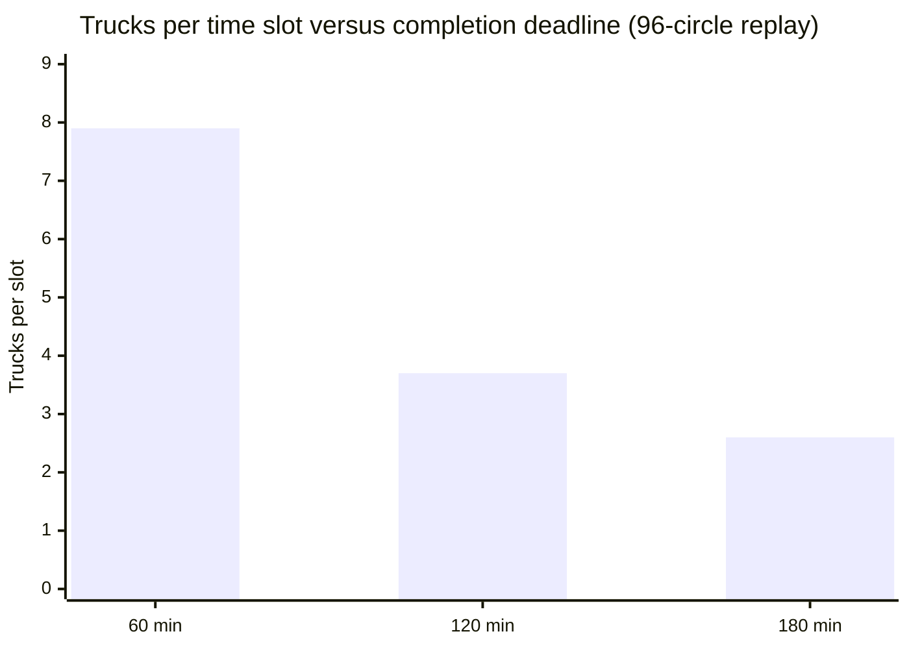

How sensitive is the result to the one assumption that cannot be measured? Average shortage that remains after ideal dispatch, by assumed number of off-dock bikes (all slots, main 72 circles):

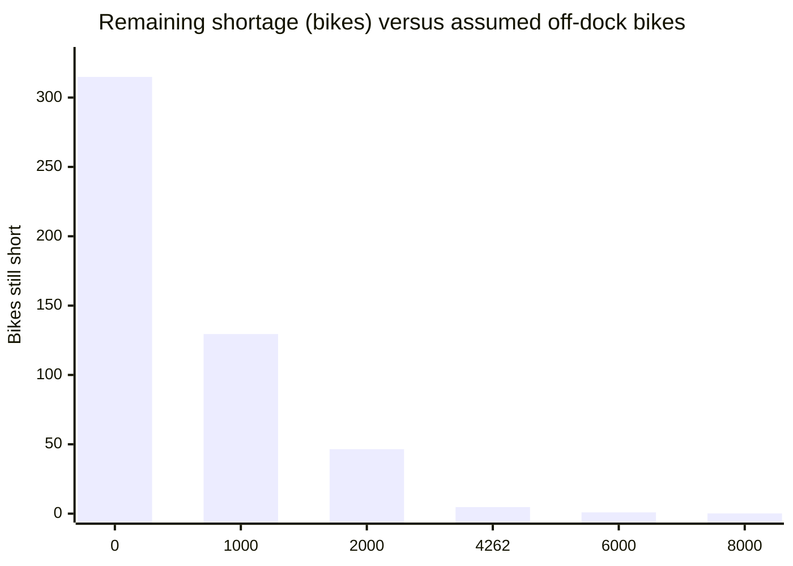

### A worked example: one truck, one trip

A trial batch from 2026-10-08. The truck loads 14 bikes at a surplus circle and unloads at three short circles, every leg within 2 km and none doubling back (straight-line distances between circle centres; schematic, not to scale):

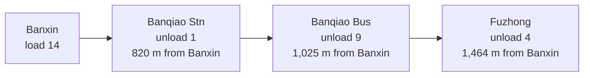

About 1.7 km in total, 14 bikes, all inside one 120-degree sector. Slides 14 and 15 of the deck show a full batch and this route.

## The edge device (concept)

The idea is that, at a full station, a rider uses a virtual dock beside the station to register a temporary return over Bluetooth (press the button on the bike unit and pair with the virtual dock). It is recorded in this study's own log, never sent into any operator system. The physical lock and billing stay with the operator; nothing here unlocks, controls a lock, or changes billing.

- **A temporary return is not an official return. Billing does not stop. Do not leave a bike outside the docks because of it. Reports are unverified signals and never drive dispatch on their own.**
- Verified so far: bike unit → advertisement → gateway on a bench (2026-08-28), and gateway → console in a local drill. Not done: uploading over the network, multiple boards, pairing with real bikes, comparison with operator data.
- Report fields: which station, how many, when, and a reporter code. No rider identity and no bike number is collected.

The sequence for one temporary return:

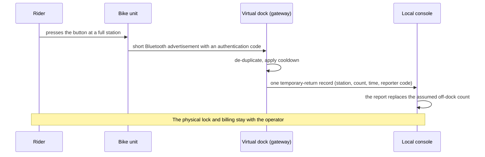

## How to read the deck

| Pages | Topic |
|---|---|
| 1–2 | Title and the question |
| 3 | Why the shortage persists (the two pieces of evidence) |
| 4–5 | Approach, and the problem with a field example |
| 6–9 | The official return process, the bike unit, related cases, rented-and-never-returned bikes |
| 10–12 | The edge device, the information value of edge reporting, the cloud demo (removed) |
| 13–15 | Peak versus off-peak, the one-button batch output, a sample route |
| 16–17 | Results, and how the proposal maps to existing arrangements |
| 18–20 | What is done, scope and next steps, data and compliance notes |

## What the local console looks like

Screenshots of the author's local console (data batch 2026-10-21 22:25, captured 23:04). The console UI is in Traditional Chinese; the strip above each image is in English. Algorithmic estimates, not operating results.

**29-district overview** (docking demand by district):

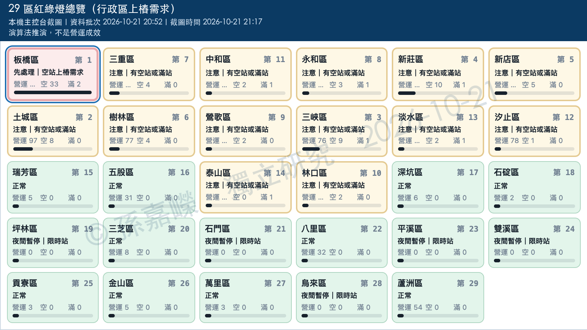

**One button**: dispatch volume per 2 km circle and circle-to-circle moves:

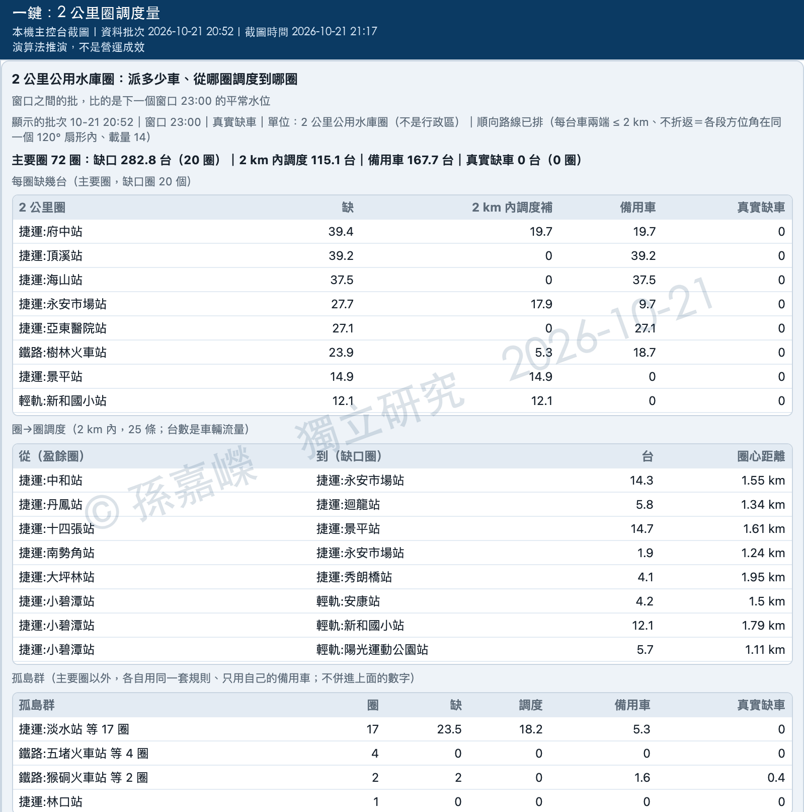

**Dispatch logic**: forward routes and the number of trucks:

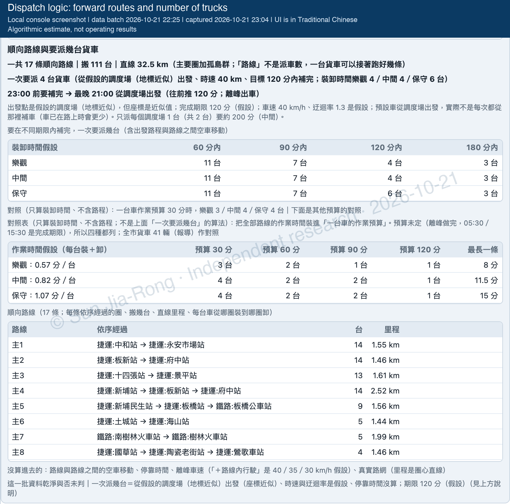

## Glossary

| Term | Meaning in this study |
|---|---|
| Off-dock bike | A bike parked beside a full station or otherwise outside the docks; absent from official station data |
| Usual level | A station's median docked bikes for a given window and day type; used as its target |
| 2 km circle | A shared-reservoir circle; a station within 2,000 m of a circle centre belongs to it; circles may overlap |
| Window | One of four evaluation times: 05:30, 10:00, 15:30, 23:00 |
| Shortage | Target level minus current docked level |
| Remaining shortage | Shortage minus truck moves minus the assumed reserve; a lower bound. It measures distance from the usual level, not hours of empty or full stations |
| Reserve | The self-estimated upper bound of 4,262 off-dock bikes, a scenario assumption |
| Forward route | An ordered run of loads and unloads: at most 14 bikes per truck, each leg at most 2 km, no backtracking |
| Temporary return | A concept: a Bluetooth report that a bike was left at a full station; not an official return |
| Clean slot | A time slot whose station data passed the quality checks (280 between 2026-07-21 and 10-15) |
| One button | The local console panel that gives routes, number of trucks and latest departure for the latest batch |

## FAQ

- **Is this running anywhere?** No. The replay and the local console run on the author's machine only. A cloud demo receiver was used briefly in October 2026 and has been removed.
- **Where does 4,262 come from?** It is a self-estimated upper bound derived from official data (the difference between docked bikes at 03:00–04:00 and the fleet lower bound). It is not a measurement, which is why the sensitivity table is part of the result.
- **Why not just predict demand?** Demand prediction cannot see bikes that are not in the data. This study asks where the invisible layer should be pre-positioned.
- **Does it need the edge device?** No. The estimate can be computed without it; the device would replace the assumed off-dock count with reports.
- **Is the data public?** The station data is public; this repo does not redistribute raw snapshots, and licensing of each source is still being verified (see [NOTICE.md](./NOTICE.md)).
- **Can I reuse the material?** Under CC BY-NC-ND 4.0: share it with credit, non-commercially, without changes. No code is included.
- **Does it work in other cities?** Unknown. Nothing here was tested outside the author's data.

## Scope and limits

- Results are replay estimates from official data. They are not operating results, there is no counterfactual, and real dispatch is the operator's job.
- The 4,262 off-dock figure is a self-estimated upper bound (a scenario assumption); results are highly sensitive to it.
- "Remaining shortage" is the value under that estimate; with fewer off-dock bikes the shortage is larger, so it is a lower bound. The console screenshots label it "真實缺車".
- The edge device has only been tested on a bench and in a local drill.
- "Remaining shortage" measures distance from each station's usual level. A value near zero does not by itself mean fewer empty or full stations; no service outcome (minutes empty or full) was measured.
- The 8%–26% share resolved directly by trucks is a replay average. The two live one-button batches published here are higher (about 54% and 49%), and the gap is not yet explained.
- The truck count was computed only for the 4,262 assumption, with no stop time and straight-line distances.
- Names such as YouBike belong to their owners; this is independent research with no affiliation or endorsement.
- News items and online posts are cited only as case illustrations; details may have changed.

## Roadmap (90-day verification path)

1. Oct–Nov 2026: end-to-end verification of bike unit + gateway uploading over the network (the October demo receiver was removed, so a new one is needed).
2. Nov–Dec 2026: with an operator, compare estimates against its official data in 2–3 two-kilometre circles (not yet approached).
3. Jan 2027: use reports to correct reserve allocation; add stop time and the real road network.

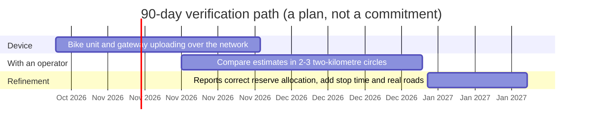

## Licence

Documents, slides, diagrams and console screenshots in this repo are provided under CC BY-NC-ND 4.0 (quoted third-party news and notices excepted); see [LICENSE](./LICENSE) and [NOTICE.md](./NOTICE.md). The author has a separate Taiwanese patent application whose subject differs from this method; this licence grants no patent rights.

## Contact and citation

Sun Jia-Rong (孫嘉嶸), jiarong0423@gmail.com

Citation: Sun Jia-Rong, 2026, Zenodo, https://doi.org/10.5281/zenodo.23537185 (this DOI always resolves to the latest version).
