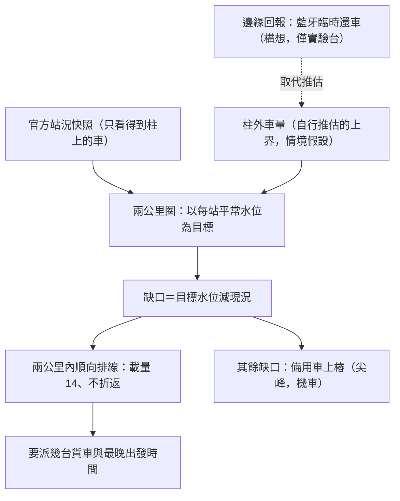

# 共享單車「臨時無車位可還」：邊緣回報＋調度演算法（概念驗證）

白話：站滿時，車會停在柱子外面，官方資料看不到。本研究用公開資料推演，只用少量貨車在離峰時間先把車預置好。

**結論只在假設下成立：** 在假設柱外備載 4,262 台時，離峰約 3.7 台貨車、120 分鐘內可補完；備載 0 台時，平日 15:30 仍缺約 522.7 台。結果完全依賴這個假設（見 METHOD 第 5 節敏感度表）。

**狀態：概念驗證。** 只有實驗台與回放推演，沒有任何現場部署；本專案是獨立研究，不是營運商或政府合約的當事方，也未獲任何營運商授權。

## 內容

| 檔案 | 說明 |
|---|---|
| [METHOD.md](./METHOD.md) | 演算法規則、邊緣裝置、敏感度表、限制 |
| [youbike_edge_dispatch_deck_20261021.pdf](./youbike_edge_dispatch_deck_20261021.pdf) | 簡報（20 頁） |
| [architecture/](./architecture/) | 架構圖 7 張（SVG）：總圖、L2、L3、L4、L5、L8、派工邏輯解耦圖 |
| [console/](./console/) | 本機主控台截圖 3 張（資料批次 2026-10-21 22:25，截圖 23:04）；與簡報第 14 頁的 18:59 批次不同批，數字不可直接比較 |
| [LICENSE](./LICENSE)、[NOTICE.md](./NOTICE.md) | CC BY-NC-ND 4.0 官方全文；授權範圍與第三方內容聲明 |

## 流程一圖看完

## 為什麼換一個問法

YouBike 站況資料公開，作者觀察它常是黑客松與資料競賽的題目（未逐屆統計）。常見做法是預測哪一站會缺車；但站況只記錄柱上的車，停在柱外的車不在資料裡。本專案換一個問法：看不見的那一層該怎麼先預置。

## 缺口為什麼長期存在

- 官方數字：112 年底到 114 年底，站點 +8.4%、車輛 +3.2%（每站 −0.8 台）；114 年底到 115-09-30，站點 +7.3%、公布車輛 +0.0%（車輛欄可能未更新）。本專案每日快照的車柱數 07-21 到 10-16 +2.7%。官方沒有公布總車柱數，所以站點數是代理。
- 5 元騎乘券（友愛接力）後統計下降：桃園「借不到」每月 15,484 到 11,450 次、「還不了」690 到 454 次，交通局稱改善約 27%、34%（聯合報 2026-06-24，桃園市交通局統計，改善率為報導數字）；但缺口仍在，誘因只能挪動一部分車。

## 要解決的問題

站內沒有空位時，車還不進去；車停在柱外或旁邊，需要通知站務人員到場，期間計費延長。官方站況只記錄柱上的車，柱外的車在資料裡不存在。

## 做法

- **只用公開資料**：不要求營運商改系統，只用公開的站況資料與自行累積的快照。
- **演算法推斷**：每站以自己平常的水位為目標；以兩公里共用水庫圈為單位，離峰少量貨車、順向預置。
- **邊緣回報（本提案可補充的環節：臨時還車）**：構想是利用藍牙，讓使用者在滿站時用站旁的虛擬柱臨時還車（按下車機按鈕、與虛擬柱配對），登記在本方案自己的紀錄，不送入營運商系統；實體鎖與扣款仍由官方負責，不解鎖、不控鎖、不改計費。
- **尖峰與離峰分工**：離峰用長窗口少量搬運（期限從 60 分鐘放寬到 180 分鐘，模型所需貨車數由 7.9 台降到 2.6 台，回放推估）；尖峰只做不需要移動車輛的機車解綁上樁。
- **原則**：在符合法規的前提下，以公開資料做有依據的推演。

## 範圍與限制

- **臨時還車不等於官方還車，計費不會停止，請勿因此把車留在柱外；回報是未驗證訊號，不單獨驅動派車。**
- 「真實缺車」（主控台與部分圖上的用詞）與「補完仍缺」（文件與簡報的用詞）是同一件事：備載假設下仍補不起來的缺口。
- 柱外車量 4,262 台是自行從官方資料推估的上界（情境假設），不是實測；結果對這個假設高度敏感。
- 結果是以官方資料回放推估，不是營運成效；沒有反事實對照；實際派車由營運單位執行。
- 邊緣裝置目前只做過實驗台與本機演練，尚未現場部署，不得安裝於未獲授權的營運車輛。
- YouBike、微笑單車、悠遊卡等名稱屬各權利人；本專案為獨立研究，與營運商無隸屬或背書關係。
- 引用的新聞與網友分享僅作案例說明，細節可能已調整。

## 授權

本 repo 的文件、簡報、架構圖與主控台截圖以 CC BY-NC-ND 4.0 提供（引用的第三方新聞與公告內容除外），詳見 [LICENSE](./LICENSE)；第三方素材見 [NOTICE.md](./NOTICE.md)。作者另有一件臺灣專利申請（標的與本文方法不同）；本授權不含專利授權。

## 聯絡

孫嘉嶸　jiarong0423@gmail.com

引用：孫嘉嶸，2026，Zenodo，https://doi.org/10.5281/zenodo.23537185（所有版本；最新版 v1.0.1 為 10.5281/zenodo.23537764）。
